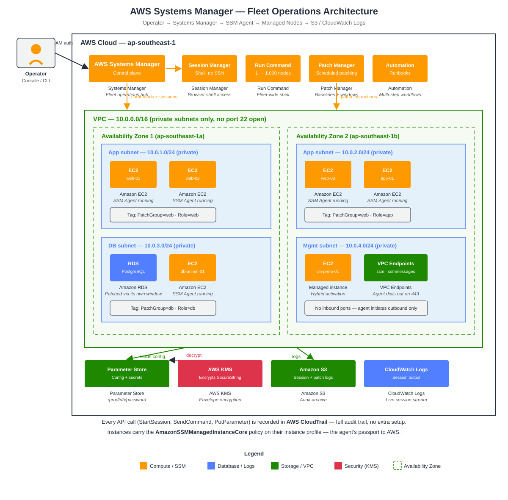

# AWS Systems Manager — Fleet Ops Without SSH


> **TL;DR** — AWS Systems Manager is the operations hub for your EC2 fleet (and on-prem servers): patch hundreds of instances on a schedule, run a shell command everywhere at once, open a shell without opening port 22, and store secrets and config in one place — all audited, all without a bastion host. This guide shows the full architecture, the security model, and a working Python demo.

---

## 📐 Architecture



**Traffic flow:** Operator → AWS Console / CLI → Systems Manager (control plane) → SSM Agent on managed nodes → EC2 / on-prem servers. State and secrets flow through Parameter Store; patch and run data lands in S3 / CloudWatch Logs; every action is recorded in CloudTrail.

---

## 🌍 In plain words — what is this, really?

Imagine you are in charge of a warehouse with hundreds of rooms, and instead of walking to every room with a key whenever something needs fixing, you sit at one control desk with a master panel. From that desk you can check what is stored in every room, send the same instruction to all rooms at once, schedule regular cleaning and repairs, and open a single room's door remotely without ever leaving the desk or handing out copies of the master key. That control desk is Systems Manager for your fleet of servers: the SSM Agent installed on each machine listens for your instructions over a secure connection, so you never need to open SSH or keep a bastion server. Run Command sends one order to hundreds of instances, Patch Manager handles scheduled updates like a maintenance calendar, and Parameter Store is the labelled cabinet where configuration values and secrets are kept. Session Manager is the remote door-opening part — a shell into one machine, fully logged, with no port 22 left open. Everything is tied to IAM permissions and recorded, so you know exactly who did what, and where.

## 🧩 The Capabilities, in One Picture

| Capability | What it does | Think of it as |
|---|---|---|
| **Session Manager** | Shell access to an instance via the browser/CLI — no SSH key, no open port 22, no bastion | A locked service door that only opens for IAM |
| **Run Command** | Execute a shell script on 1 or 1,000 instances at once, with per-target results | Shouting one instruction to the whole warehouse |
| **Patch Manager** | Scan and patch OS + apps on a schedule, with maintenance windows and approval rules | The vaccination schedule for your fleet |
| **Parameter Store** | Hierarchical config and secrets (`/prod/db/password`, SecureString via KMS) | The labelled key cabinet |
| **State Manager** | Desired-state associations (e.g. "every node must have the CloudWatch agent") | The house rules that re-apply themselves |
| **Automation** | Multi-step runbooks (e.g. patch → reboot → health check → roll back on failure) | The checklist that runs itself |
| **Fleet Manager / Inventory** | One dashboard: OS versions, installed software, compliance drift | The stock-taking clipboard |
| **Distributor** | Package and version your own software bundles for fleet-wide install | Your private app store |

---

## 🔑 How the SSM Agent Talks to AWS (and Why No Inbound Ports Are Needed)

The SSM Agent on each node opens an **outbound** HTTPS connection (port 443) to the Systems Manager endpoints and waits for instructions. Nothing listens inbound.

| Setup | How it works | When to use it |
|---|---|---|
| **Public subnet, public IP** | Agent reaches the public SSM endpoints directly | Dev/test only — avoid in production |
| **Private subnet + NAT Gateway** | Agent goes out through NAT to the public endpoints | Simple, works everywhere, costs NAT data fees |
| **Private subnet + VPC endpoints** | Agent talks to `ssm`, `ssmmessages`, `ec2messages` interface endpoints inside the VPC | ✅ Production default — traffic never leaves AWS |
| **On-prem / other cloud** | Register the server as a **managed instance** (hybrid activation) — same agent, same console | Mixed fleets, migration periods |

> ⚠️ **The #1 mistake:** launching instances in a private subnet with no NAT and no VPC endpoints, then wondering why they never appear in Fleet Manager. The agent can't phone home. Add the three endpoints above (or a NAT) and the node shows up within minutes.

---

## 🛡️ Security Model — IAM Is the New SSH Key

| Old way (SSH) | Systems Manager way |
|---|---|
| Key pairs on laptops, shared `.pem` files | IAM identity + MFA; no long-lived key material |
| Port 22 open to the world (or a bastion to babysit) | Zero inbound ports; agent dials out on 443 |
| `~/.bash_history` on the box, if you're lucky | Every session logged to **S3 + CloudWatch Logs**, every API call in **CloudTrail** |
| `sudo` for everyone who has the key | Fine-grained IAM: `ssm:StartSession` only on tagged instances, only during work hours |
| Revoking access = rotating keys everywhere | Revoke the IAM permission — access dies instantly |

**Minimum IAM policy for an operator who may only start sessions on prod web servers:**

```json
{
  "Version": "2012-10-17",
  "Statement": [
    {
      "Effect": "Allow",
      "Action": ["ssm:StartSession"],
      "Resource": [
        "arn:aws:ec2:ap-southeast-1:123456789012:instance/*"
      ],
      "Condition": {
        "StringEquals": {
          "ssm:resourceTag/Environment": "prod",
          "ssm:resourceTag/Role": "web"
        }
      }
    },
    {
      "Effect": "Allow",
      "Action": ["ssm:TerminateSession", "ssm:ResumeSession"],
      "Resource": ["arn:aws:ssm:ap-southeast-1:123456789012:session/*"]
    }
  ]
}
```

And every instance needs the **`AmazonSSMManagedInstanceCore`** managed policy on its instance profile — that is the agent's passport to AWS.

---

## 🗓️ Patching That Doesn't Wake Anyone Up

A sane patching rhythm:

1. **Patch baselines** — define what counts as "approved": security patches only, or all patches; auto-approve critical patches after N days.
2. **Maintenance windows** — e.g. every Sunday 02:00–04:00, targeting instances tagged `PatchGroup=web`.
3. **Patch groups** — tag instances (`PatchGroup=web`, `PatchGroup=db`) so one baseline serves many fleets.
4. **Canary first** — patch 1 instance, wait for the CloudWatch alarm to stay green, then roll to the rest.
5. **Automation runbook** — `AWS-RunPatchBaseline` with a reboot step, and a rollback association if the health check fails.

```bash
# See what's missing before patch day
aws ssm describe-instance-patch-states \
  --instance-ids i-0123456789abcdef0 \
  --query 'InstancePatchStates[0].{Missing:MissingCount, Installed:InstalledCount}'
```

---

## 💻 Quick Start — Run a Command on the Whole Fleet

```bash
# 1. Check which instances the agent can see
aws ssm describe-instance-information \
  --query 'InstanceInformationList[*].{Id:InstanceId, OS:PlatformName, Agent:AgentVersion}'

# 2. Run one command everywhere tagged Role=web
aws ssm send-command \
  --document-name "AWS-RunShellScript" \
  --targets "Key=tag:Role,Values=web" \
  --parameters 'commands=["df -h / | tail -1", "uptime"]' \
  --comment "Disk check before patch window"

# 3. Read the results (per instance, with exit code)
aws ssm list-command-invocations \
  --command-id <command-id> --details \
  --query 'CommandInvocations[*].{Instance:InstanceId, Status:Status, Output:StandardOutputContent}'
```

Or do it in Python — see [`systems_manager_demo.py`](systems_manager_demo.py) for a full walkthrough: inventory, Parameter Store (plain + SecureString), Run Command with polling, and a patch-compliance report.

---

## 🧠 Common Traps

- **Agent not registered** — wrong IAM role, or the instance profile attached *after* launch without a restart of the agent. Attach `AmazonSSMManagedInstanceCore` **before** launch.
- **Session Manager logging off** — enable S3/CloudWatch logging in Session Manager preferences; otherwise sessions are unaudited.
- **Parameter Store free tier limits** — Standard parameters are free (up to 10,000) but cap at 4 KB; Advanced parameters cost money and allow 8 KB + policies. Don't store big blobs here — use S3 + a pointer.
- **Run Command timeouts** — default timeout is 3,600 s per invocation; long scripts need `--timeout-seconds` raised or split into Automation steps.
- **Patching the database tier with the web tier** — separate patch groups and windows; a rebooted DB mid-traffic is a very bad morning.

---

## 📚 Further Reading

- [AWS Systems Manager User Guide](https://docs.aws.amazon.com/systems-manager/latest/userguide/)
- [Session Manager — logging and auditing](https://docs.aws.amazon.com/systems-manager/latest/userguide/session-manager-logging.html)
- [Patch Manager — patch baselines](https://docs.aws.amazon.com/systems-manager/latest/userguide/sysman-patch-baseline.html)
- [Parameter Store — hierarchies and SecureString](https://docs.aws.amazon.com/systems-manager/latest/userguide/systems-manager-parameter-store.html)
